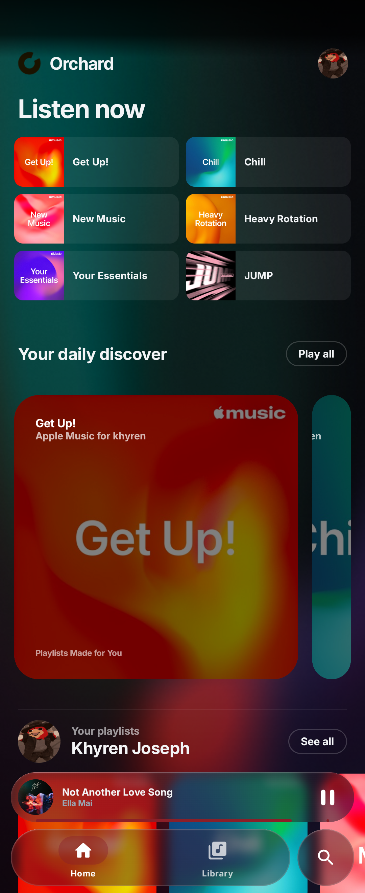
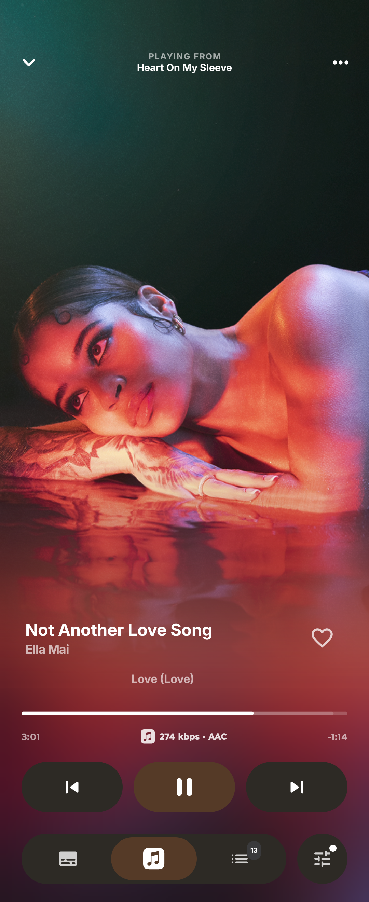
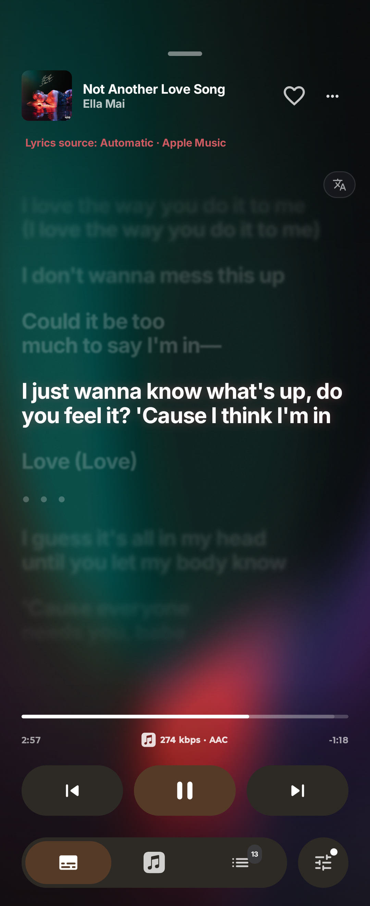
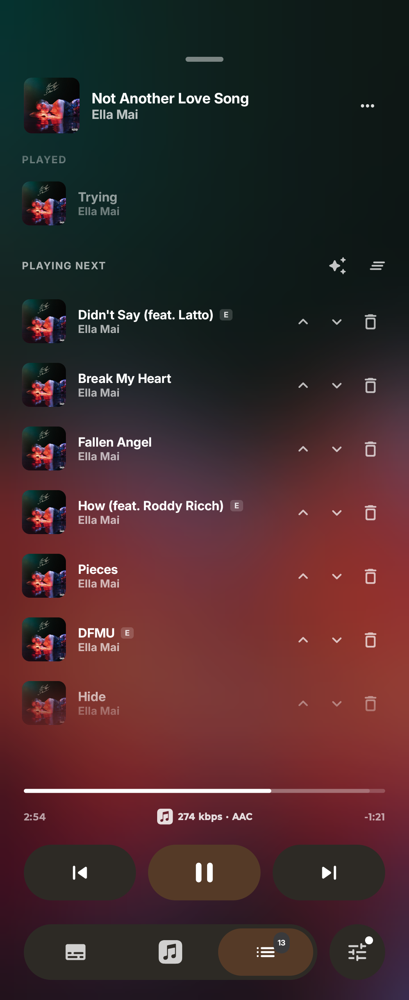
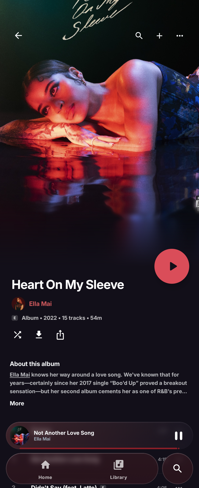

<div align="center">
  

# Orchard Mobile

**A power-user Android client for YouTube Music.**

Smart Crossfade with real beat matching, on-device track analysis, synced lyrics, animated artwork, Android Auto, Orchard Connect, and a full library that works signed in or signed out.

[](LICENSE)
[](#install)
[](https://ko-fi.com/sfg545)

[Orchard for desktop](../) · [Report an issue](https://github.com/SFG5453/Orchard/issues) · [Support on Ko-fi](https://ko-fi.com/sfg545)

</div>

---

Orchard Mobile is the phone half of [Orchard](../) — a standalone native Android app, not a remote control for the desktop client. It plays music on its own, keeps its own library, and signs into YouTube Music directly. Orchard is not affiliated with or endorsed by YouTube or Google.

## Why Orchard Mobile?

* **Transitions that actually mix.** Smart Crossfade analyzes both tracks on the device, finds the downbeat, time-stretches one to meet the other, and rides a filter through the blend. When the evidence isn't there, it falls back to a normal fade.
* **It does the analysis itself.** Beat grids, tempo, key, energy, and vocal presence are computed on the phone from the audio.
* **Everything the phone can show.** Synced lyrics, animated cover art when a provider has it, artwork-derived accent colors, and offline caching for instant replays.

## Screenshots

<div align="center">
  
  
  
  
  
</div>

## Features

### Playback

* Smart Crossfade with beat-matched, phrase-aligned transitions, or a fixed crossfade of 1–12 seconds
* Gapless playback for albums played in order
* Queue with reordering, removal, history, and restore after the app is killed
* Media notification, lock-screen controls, headset and Bluetooth buttons, audio focus
* Exponential volume for finer control at low media-volume levels, available in Audio settings and welcome setup, saved and off by default
* Artwork-tinted home-screen widgets for playback controls and recent tracks
* Android Auto browsing and voice search
* Playback history
* Skip non-music parts (talking intros, skits, applause) from SponsorBlock, as a button or automatically, with lyrics staying in sync

### On-device analysis

Orchard listens to the audio rather than trusting a catalog. Smart Crossfade and Best Mix run the desktop adaptive-mix worker's own Rust (`crates/orchard-adaptive-mix`) in process: Earmark's beat tracker and analysis, the Nirovi beat model's bar-phase check, open-unmix vocals, the QuickJS planner (`crates/orchard-transition-planner`) and the Earmark render. Kotlin only decodes the songs at their native rate and splices the rendered overlap into ExoPlayer (`MixSplicer`), so a pair mixes and a queue sorts as it does on desktop. The decoder (MediaCodec here, FFmpeg there) and the beat model's weights (INT8 here, FP16 on desktop GPUs) are the only differences.

### Library and browsing

* Home, search, library, playlists, albums, and artists
* Native YouTube Music sign-in through a dedicated Compose screen - sign in for your library, or skip it and browse as a guest
* Offline metadata cache and a configurable audio cache for instant re-listens
* Synced and unsynced lyrics with provider switches, saved priority order, and a source picker for each song

Open **Settings → Appearance → Lyrics providers** to enable Bini Lyrics, BetterLyrics, LyricsPlus, LRCLIB, or YouTube Music and move them up or down. The first enabled provider with lyrics wins. In the lyrics player, use **Lyrics source** to choose a different provider for the current song, or return to **Automatic**. Song-specific choices last for the current app session; the global order and switches are saved.

While signed in to Apple Music, Apple Music replaces Bini Lyrics, BetterLyrics, and LyricsPlus in settings and the song source picker. Its synced lyrics lead by default, with LRCLIB and YouTube Music available as fallbacks. Signing out restores the mirror providers and their saved settings.

Animated artwork quality is set separately for Wi-Fi and mobile data under **Settings → Appearance → Player**. Choose **Automatic** to adapt to connection speed, **Data saver** for lower data use, **Balanced** for sharper covers, or **Highest** for the best available rendition. Both default to Automatic. Metered Wi-Fi uses the mobile data setting. Quality choices apply when the source offers multiple qualities; saved covers keep their downloaded quality.

### Connected listening

* **Orchard Connect** - control Orchard desktop from the phone or the phone from the desktop, on the same Wi-Fi or across the internet, while a connected desktop prepares Smart Crossfades and artwork for the phone
* **Chromecast** - move the active queue to Cast speakers and displays, then bring it back without losing position
* **Last.fm and ListenBrainz** - encrypted account credentials, now-playing updates, and seek-resistant scrobbling
* **Orchard account** - Google sign-in, an encrypted device session, and device management in Settings
* **Apple Music** - sign in with MusicKit JS in a WebView; the session cookies persist and the WebView closes after sign-in
* Discord Rich Presence, with animated artwork where available and an artist portrait over the cover
* Direct YouTube Music share links, matching desktop

## Install

- Download the latest apk at https://sfg545.dev/orchard

Catalog, library, lyrics and stream URLs come from the desktop YouTube provider (`providers/youtube`), run in the same QuickJS build as desktop. Gradle bundles it with npm and compiles it with the host `qjsc`, so install its dependencies first (Node.js 24.11+, CMake):

```bash
npm ci --prefix providers/youtube
cd mobile/android
./gradlew assembleDebug
adb install -r app/build/outputs/apk/debug/app-debug.apk
```

Launch **Orchard** from the app drawer. Sign in from **Profile → Account** to play songs and load your library; playback requires a YouTube session, as on desktop.

Release builds are signed from `ANDROID_KEYSTORE_FILE`, `ANDROID_KEYSTORE_PASSWORD`, `ANDROID_KEY_ALIAS`, and `ANDROID_KEY_PASSWORD`:

```bash
./gradlew assembleRelease
```

### Fast Canary testing

For local testing with debugger overhead disabled and shorter incremental
builds, use the ARM64 `canaryFast` build:

```sh
./gradlew assembleCanaryFast
adb install -r app/build/outputs/apk/canaryFast/app-canaryFast.apk
```

It is non-debuggable, uses release dependencies and optimized native libraries,
and skips R8 minification and resource shrinking. It does not include the
debug-only Compose tooling or automatic release lint checks. Full Canary and
release builds also apply R8's code optimizations; use those for final
performance and compatibility checks.

For the x86_64 emulator, use `canaryFastX86`. It has the same optimizations and
packages only x86_64 libraries:

```sh
./gradlew assembleCanaryFastX86
adb install -r app/build/outputs/apk/canaryFastX86/app-canaryFastX86.apk
```

It installs as **Orchard Canary Fast x86_64** and shares the Canary x86_64
application ID.

The launcher label is **Orchard Canary Fast**, with Canary's yellow icon.
It shares Canary's application ID and signing configuration, so installing it
replaces Canary and retains its sign-ins and settings. It uses the local debug
signing key when release signing credentials are absent. Automatic updates are
disabled.

## Apple Music sign-in

Open **Settings → Connections → Apple Music** and select **Sign in to Apple
Music**. The app fetches a developer JWT from the account worker's
`GET /apple/developer-token` endpoint and runs MusicKit JS in a WebView, so
no Apple SDK is bundled. Configure and deploy the
[account worker](../services/account/README.md#apple-music-developer-tokens)
first. Sign in to your Orchard account before connecting Apple Music; the
worker only issues developer tokens to Orchard sessions.

The WebViews exist only while the sign-in screen is open. Apple's cookies stay
in the app's WebView cookie jar, so signing in again reuses the session. The
Music User Token is encrypted with Android Keystore. **Disconnect** removes the
token, Apple's cookies and the MusicKit page storage; other services keep their
sign-ins. Choose **Apple Music** under **Music source** in **Settings →
Appearance → Home screen layout → Online** to use its catalog for Home, search,
artists, albums and playlists. Choose **YouTube Music** to browse YouTube Music.
Apple Music connection and loading errors stay visible without switching catalogs.
Your library remains on YouTube Music. Apple Music playback is not available yet;
Apple Music tracks keep their provider identity and are not matched to YouTube Music.

The Apple Music logo is optional and not tracked in Git. Place a square PNG at
`mobile/android/local/apple-music/res/drawable-nodpi/apple_music_logo.png` and a
one-color vector at `mobile/android/local/apple-music/res/drawable/apple_music_mark.xml`
to show it in Settings and on the now playing source mark. CI builds restore both
from the `APPLE_MUSIC_LOGO_PNG_BASE64` and `APPLE_MUSIC_MARK_XML_BASE64` secrets.

## Orchard Connect

Sign in to the same Orchard account on the phone and the desktop. Each one then lists the other: on the phone, open the devices sheet from the full player; on the desktop, select the cast button in the player bar. Pick a device to play there, and pick this phone to bring playback home.

The account service introduces the devices and hands both a fresh session key. They connect directly on the local network when they can and over WebRTC otherwise, and prove that key to each other before anything else crosses. When the desktop controls a playing phone, the phone sends each pair of songs to the desktop, which plans and renders the Smart Crossfade and sends the blend back; the phone still plays it on its own clock, and mixes for itself whenever the desktop is gone. Qobuz and YouTube sign-ins never leave their device.

Phone and desktop run the same C++ protocol core (`core/native/connect`), reached here through JNI. See [docs/CONNECT.md](../docs/CONNECT.md).

## Development

```bash
cd android
./gradlew testDebugUnitTest assembleDebug lintDebug
```

The unit suite covers auth signing, queue edits and restoration, playback state, artwork matching, transition filtering and planning, the Connect wire format, remote commands and transfers, and remote mixes. The protocol itself is tested once, on desktop, with two real nodes talking over loopback sockets and WebRTC. Instrumented tests cover the analysis models, which need a real device.

Model provenance lives in [Nirovi's README](../models/nirovi/README.md) and [the vocal model's README](../models/vocal-separation/README.md).

### Project map

```text
android/app/src/main/java/dev/sfg/orchard/
  mobile/playback/    Media3 service, stream resolution, queue rules
  mobile/playback/smart/  Analysis, transition planning, rendering
  mobile/catalog/     YouTube Music API boundary
  mobile/artwork/     Static and animated cover art providers
  mobile/auth/        Cookie-session auth and Keystore storage
  mobile/lyrics/      Lyrics resolver chain
  mobile/connect/     Orchard Connect: hub socket, target, provider and mix host clients
  mobile/lastfm/      Last.fm authorization and scrobbling
  mobile/listenbrainz/ Direct ListenBrainz submission
  mobile/ui/          Compose theme, navigation, screens
  connect/app/        Launcher activity
android/app/src/main/cpp/
  connect/            JNI bridge to the shared Orchard Connect core
  analyzer/           Log-mel front end and tempo analysis
  transition/         Time-stretch and transition rendering
```

## Support

If you enjoy using Orchard Mobile and would like to support its development, consider [buying me a coffee on Ko-fi](https://ko-fi.com/sfg545).

## License

Orchard Mobile is free software under the [GNU Affero General Public License v3.0 or later](LICENSE).

Copyright © 2026 SFG545.

AGPL rather than GPL so code can move freely between here and Orchard desktop, which is also AGPL-3.0. The native analysis front end and the transition engine are both shared source, and more is expected to be.

### Third-party components

Smart Crossfade ships trained models. Both were chosen because their **weights**, carry a permissive license. Most published music-information-retrieval weights, Essentia's included, are CC BY-NC-SA and cannot be distributed in an application.

* **Nirovi**: Orchard's beat and downbeat model, distilled from [Beat This!](https://github.com/CPJKU/beat_this) `final0` (Foscarin, Schlüter & Widmer, ISMIR 2024; code and weights MIT). Mobile ships its INT8 graph. See [models/nirovi/README.md](../models/nirovi/README.md).
* **open-unmix** (Stöter & Liutkus, Inria/SigSep) — used only to measure how much vocal content is present at a given instant. Code and the umxhq weights both MIT, confirmed on the weights' own [Zenodo deposit](https://zenodo.org/record/3370489). Only the `vocals` target ships, cut to the bins vocal presence reads and quantized to INT8. Meta's htdemucs separates better but releases its weights under CC-BY-NC-4.0, which a distributed app cannot ship.
* **ONNX Runtime** (Microsoft) — MIT.
* **[QuickJS-ng](https://github.com/quickjs-ng/quickjs)**: runs the shared provider and planner JavaScript, from `third_party/quickjs`. MIT.
* **[SimpMusic](https://github.com/maxrave-dev/SimpMusic)** (maxrave-dev): the full-bleed player's smoothstep scrim and canvas layout are adapted from SimpMusic v2.2.0. GPL-3.0, combined under AGPL-3.0 section 13. See `ui/components/SmoothScrim.kt`.
* **[libdatachannel](https://github.com/paullouisageneau/libdatachannel)** (Paul-Louis Ageneau): Orchard Connect's WebSocket and WebRTC data channel transports, from `third_party/libdatachannel` with its bundled libjuice, usrsctp and plog. MPL-2.0, with libjuice under MPL-2.0, usrsctp under BSD-3-Clause and plog under MIT.
* **[Mbed TLS](https://github.com/Mbed-TLS/mbedtls)**: DTLS for the data channel, and the HKDF, HMAC and ChaCha20-Poly1305 behind Connect's session encryption, from `third_party/mbedtls`. Apache-2.0 OR GPL-2.0-or-later; Orchard uses it under Apache-2.0.
* **[nlohmann/json](https://github.com/nlohmann/json)**: JSON in the Connect core, from `third_party/json`. MIT.
* **earmark** — the beat-aware crossfade engine that plans and renders every transition, shared with Orchard desktop and vendored at `crates/earmark`. PolyForm Shield License 1.0.0, see `crates/earmark/LICENSE`. It reaches Kotlin through JNI and time-stretches with [Signalsmith Stretch](https://github.com/Signalsmith-Audio/signalsmith-stretch) (MIT).
